# DevSecOps Pipeline: Gitleaks, Semgrep and Trivy

A CI/CD security pipeline built with GitHub Actions on a **deliberately vulnerable Flask app**. Every push and pull request is automatically scanned for leaked secrets, insecure code and vulnerable dependencies.

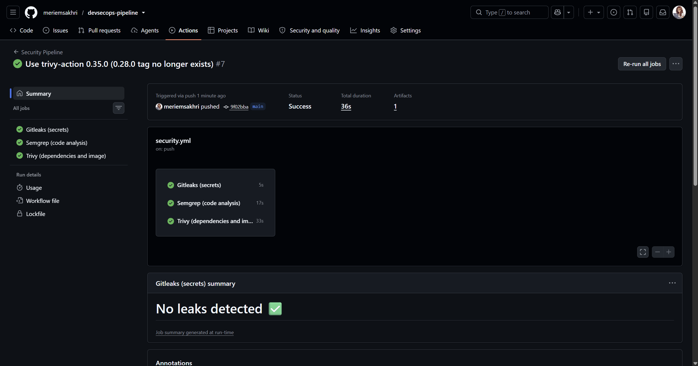

> **Disclaimer:** `app.py` was intentionally written with vulnerabilities for learning purposes, and every secret in this repository's history is fake. Do not deploy this app.

## Why this project

I wanted to understand how security checks can be automated inside a development workflow ("shift left"), instead of only reading about it. The goal was not to get a green pipeline at the first try, but to **break things on purpose, watch each tool catch the problem, then fix it**.

## How the pipeline works

````mermaid
flowchart LR
    A[git push / pull request] --> B[Gitleaks<br/>secrets]
    A --> C[Semgrep<br/>SAST]
    A --> D[Trivy<br/>dependencies + image]
    B --> E{All green?}
    C --> E
    D --> E
    E -->|yes| F[Safe to merge]
    E -->|no| G[Blocked]
````

| Tool | Type | What it catches |
|------|------|-----------------|
| [Gitleaks](https://github.com/gitleaks/gitleaks) | Secret scanning | API keys and passwords in the code and in the full Git history |
| [Semgrep](https://semgrep.dev) | SAST | Vulnerable code patterns (SQL injection, XSS, debug mode) |
| [Trivy](https://trivy.dev) | SCA + image scan | Known CVEs in Python dependencies and in the Docker image |

The three jobs run in parallel on GitHub-hosted runners and fail the build on any finding (HIGH and CRITICAL only for Trivy, unfixed CVEs ignored). Everything is free and open source.

## What I found and fixed

### 1. Hardcoded secret (Gitleaks)

A fake API key committed in `config.py` was detected by the `generic-api-key` rule, with the file, the line and the commit.

| Clean run | Secret detected | After the fix |
|---|---|---|
| 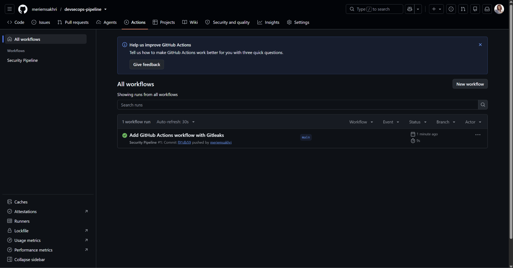 | 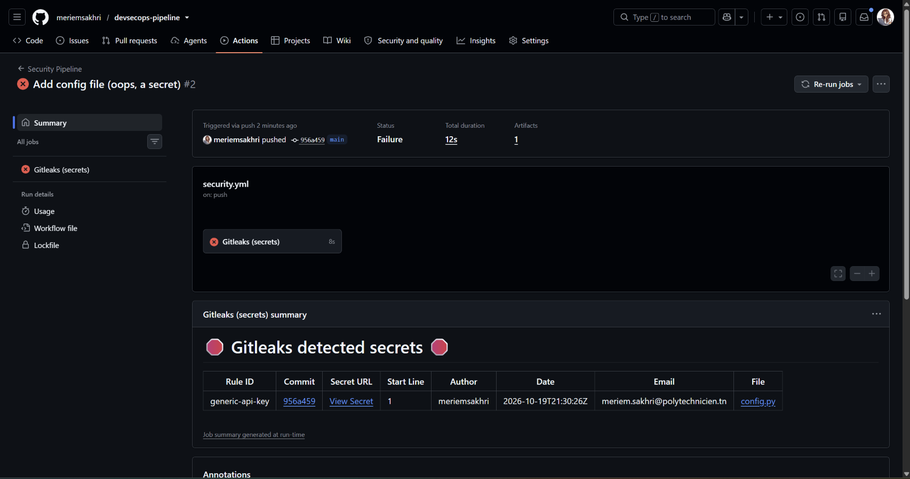 | 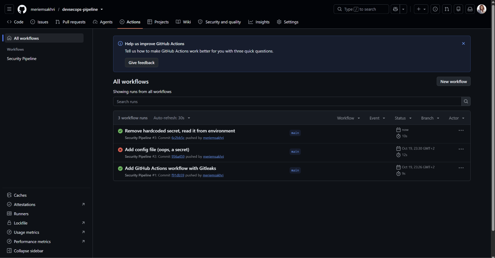 |

**Fix:** the code now reads the secret from an environment variable.

**Key point:** deleting the file is not enough, because the secret stays in the Git history. A leaked secret must be treated as compromised and **revoked**. Here the key is fake, so the old finding is documented in `.gitleaksignore`.

### 2. SQL injection, XSS and debug mode (Semgrep)

Semgrep reported 5 blocking findings in `app.py`.

| Pipeline failing | Findings |
|---|---|
| 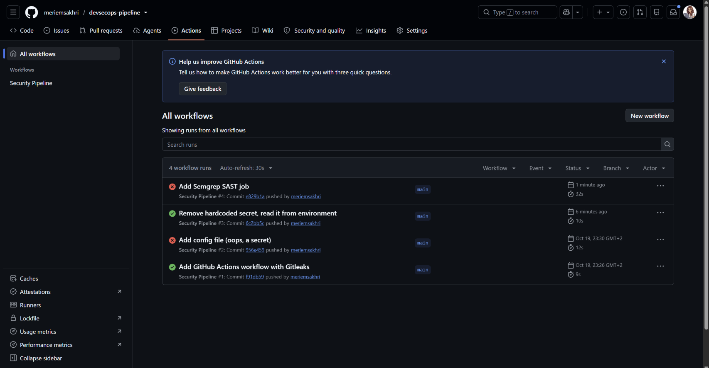 | 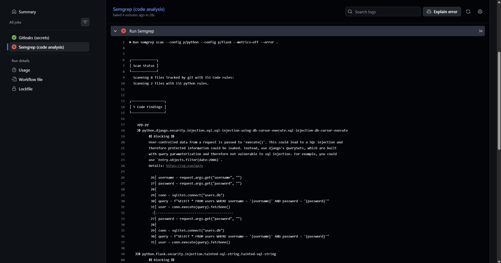<br>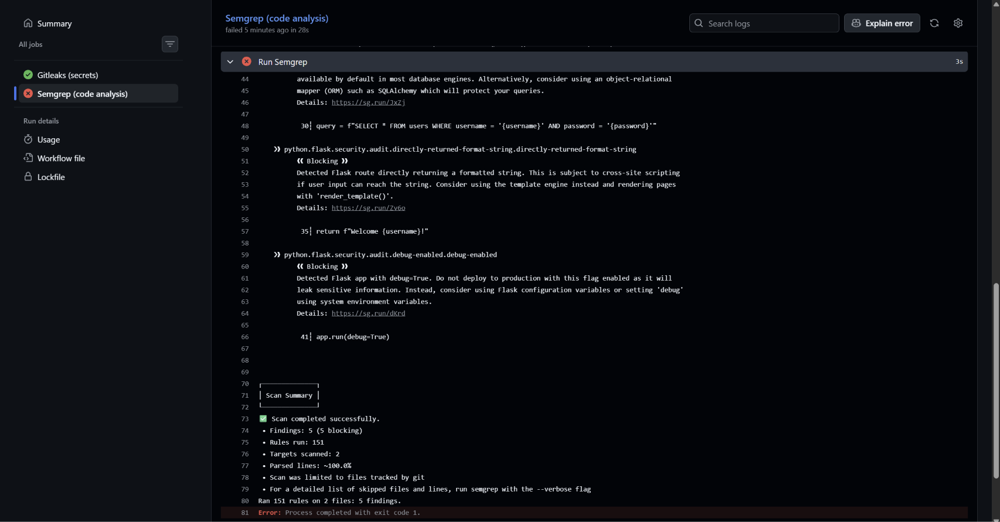 |

Before fixing anything, I exploited the SQL injection by hand: `/login?username=admin'--&password=wrong` bypassed authentication, because `--` turns the password check into a SQL comment.

| Vulnerability | Fix |
|---|---|
| SQL injection (f-string in the query) | Parameterized query with `?` placeholders |
| Reflected XSS | Jinja auto-escaping through `render_template_string` |
| `debug=True` | Debug mode driven by an environment variable, off by default |
| Plaintext password (found on my own) | Password hashing with Werkzeug (`scrypt`) |

After the fix the same attack returns `Invalid credentials`, and the pipeline is green again:

| Attack blocked locally | Semgrep green |
|---|---|
| 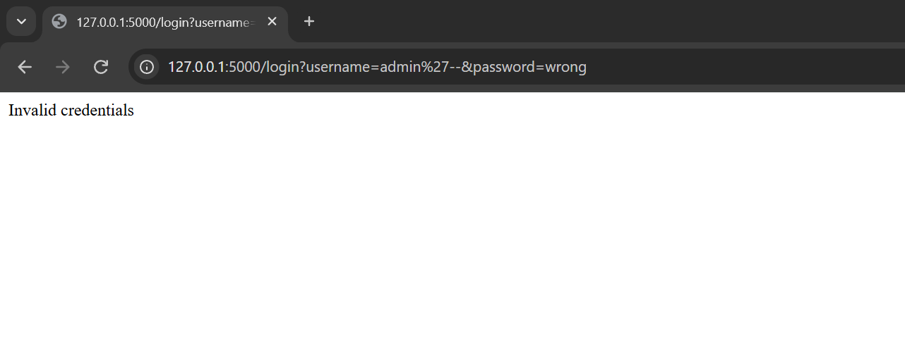 | 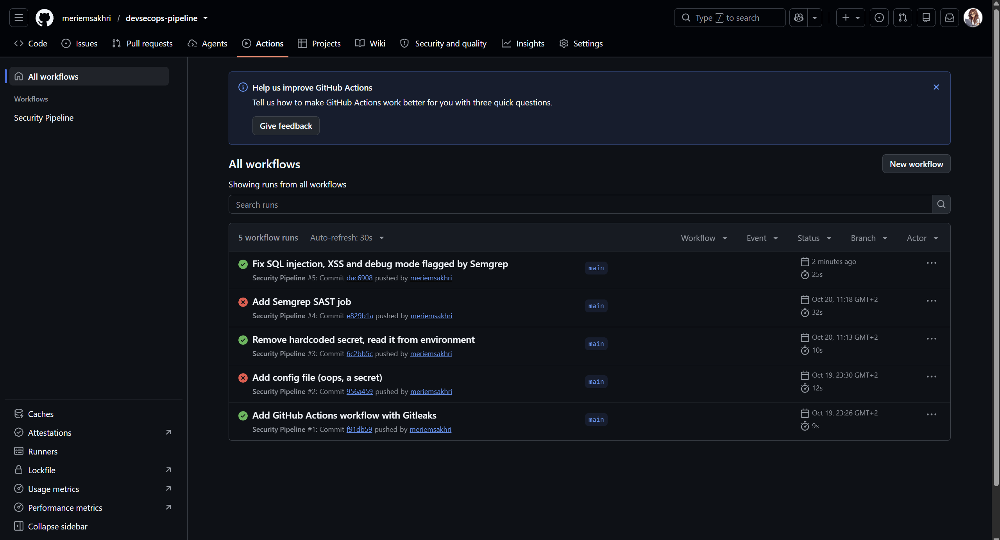 |

### 3. Vulnerable dependencies (Trivy)

To prove the scanner really works, I opened a pull request that deliberately downgraded Flask and Werkzeug. Trivy blocked it with 3 HIGH CVEs.

| PR blocked | CVE table |
|---|---|
| 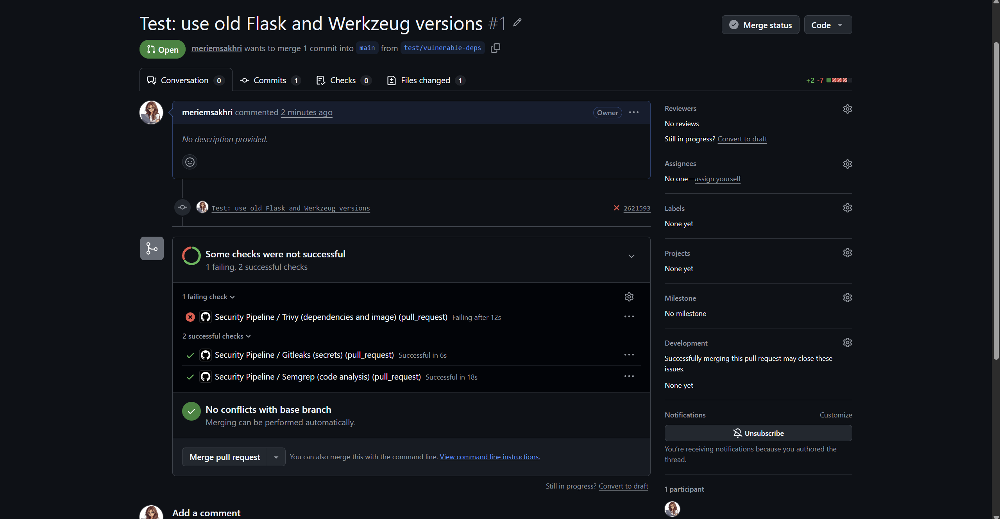 | 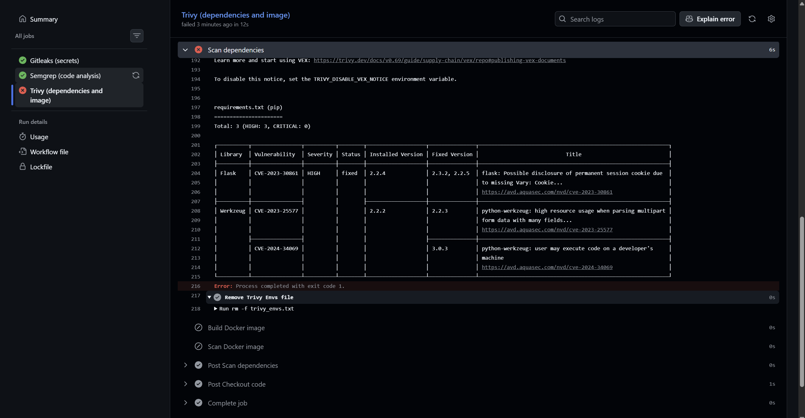 |

| Library | CVE | Fixed in |
|---|---|---|
| Flask 2.2.4 | CVE-2023-30861 | 2.2.5 |
| Werkzeug 2.2.2 | CVE-2023-25577 | 2.2.3 |
| Werkzeug 2.2.2 | CVE-2024-34069 | 3.0.3 |

Restoring the safe versions turned the pull request green again, including the Docker image scan:

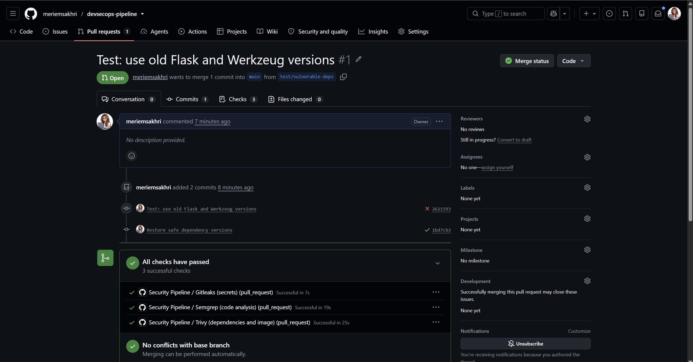

## Lessons learned

- **A scanner that never fails proves nothing.** Gitleaks, Semgrep and Trivy all started green. I triggered each of them on purpose (a fake secret, a vulnerable route, old dependencies) to be sure they really detect problems before trusting them.
- **Deleting a leaked secret does not fix the leak.** The secret stays in the Git history, and anyone can read it with `git log`. The correct response is to revoke it, generate a new one, and keep it out of the code (environment variables or GitHub Secrets).
- **Parameterized queries remove SQL injection by design.** The query structure and the user data are sent separately, so input like `admin'--` is searched as a plain username and is never interpreted as SQL. Reproducing the attack by hand before fixing it made this much clearer than reading about it.
- **A security tool can itself be a supply chain risk.** My first Trivy workflow failed because the `trivy-action` version tag I used no longer existed: that action had been compromised in March 2026 and its tags were removed. I switched to a version confirmed as safe, and learned that pinning actions to an immutable commit SHA is better than trusting a mutable tag.
- **Findings are not all equal.** Trivy is set to HIGH and CRITICAL with unfixed CVEs ignored, otherwise the noise makes the pipeline unusable. One of the fixes (Werkzeug 3.x) also requires a major version upgrade, which in a real project means testing the app afterwards.
- **Test the right thing.** At one point my "fixed" app still looked vulnerable because an old server was still running on port 5000 and answering my browser. I found it with `netstat`, and now I always stop the previous process before retesting.

## Skills practiced

Git and GitHub (branches, pull requests), GitHub Actions (jobs, containers, triggers), Docker (Dockerfile, image scanning), secure coding in Python/Flask (injection, XSS, password hashing, secrets management), reading CVE reports, and Windows/PowerShell tooling.

## Run it locally

````bash
python -m venv venv
venv\Scripts\activate        # Windows
pip install -r requirements.txt
python app.py
````

Then open `http://127.0.0.1:5000/login?username=admin&password=S3cretPass!`.

## Project structure

````
.
├── .github/workflows/security.yml   # the pipeline (3 parallel jobs)
├── docs/images/                     # screenshots used in this README
├── app.py                           # Flask app (fixed version)
├── config.py                        # reads the secret from the environment
├── Dockerfile                       # image scanned by Trivy
├── .dockerignore
├── requirements.txt
└── .gitleaksignore                  # known fake secret in the history
````

## Next steps

- Pin all GitHub Actions to commit SHAs
- Add a DAST scan (OWASP ZAP) against the running app
- Generate an SBOM and sign the image
- Add Dependabot for automatic dependency updates